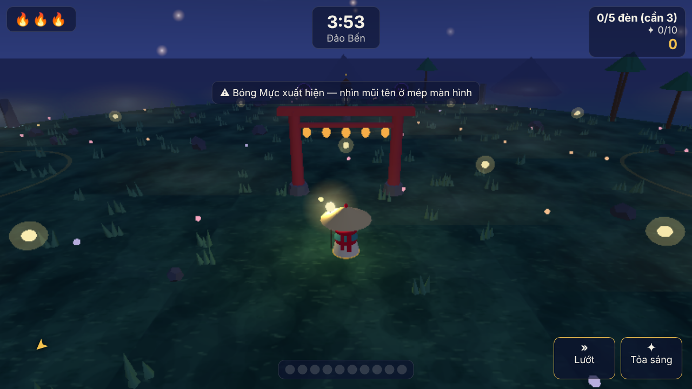
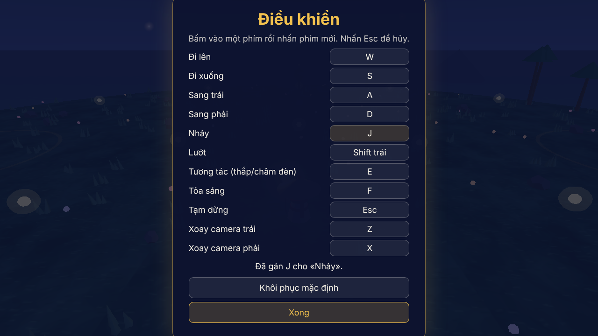
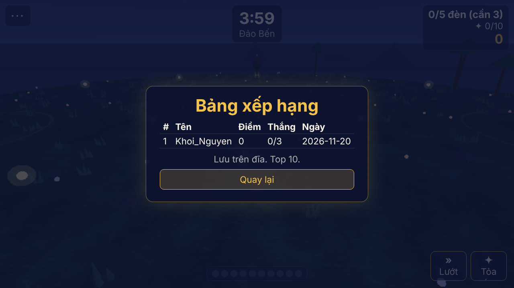

# Đảo Đèn Lồng

> **Video demo:** chưa có (bỏ qua ở Phase 4). Minh chứng chạy thật: `bench.json`, `soak.json`, `docs/proof/` và ảnh trong `docs/media/`.

Game 3D góc nhìn thứ ba: **Mây**, người giữ đèn nhỏ tuổi đội nón lá, chạy khắp đảo nhặt đom đóm để thắp lại 5 Đèn Lồng Lớn, và né **Bóng Mực** trong sương đen. Bài Day 12 (AI SDLC) của Nguyễn Khôi Nguyên, MSSV 2A202603453.



Ba Đêm: **Đảo Bến** (đảo tròn), **Đảo Cau** (hai đảo nối bằng cầu tre và bục nhảy, có Gió Lạc và Bùa Gió), **Đảo Chuông** (ba tầng, dốc, bục nhảy lên đỉnh tháp, gió mạnh). Nhật ký làm từng phase: `docs/notes/`.

## Chạy (3 lệnh, Windows / macOS / Linux, cần Node.js ≥ 20)

```bash
npm install      # không có thư viện ngoài (Three.js đã kèm trong web/vendor), lệnh này chạy gần như tức thì
npm run play     # mở http://localhost:8080 trên trình duyệt (đổi cổng: PORT=9000 npm run play)
npm test         # ~113 test: Test Contract v1.0–v1.3, tất định, bot thắng được, lõi thuần, bảng xếp hạng
```

Chế độ headless (theo Test Contract v1.3, không cần cửa sổ/GPU; `--night` nhận 1, 2, 3):

```bash
node src/headless/cli.mjs --seed 42 --night 2 --ticks 3000 --out out.jsonl \
  --scenario docs/samples/scenario.example.json --inputs docs/samples/inputs.example.json
```

Bot tự chơi để kiểm tra màn chơi thắng được: `npm run bot -- --night 1` (đứng yên thì thua; thêm `--calm` để tắt kẻ địch và chứng minh mọi đèn trên Đêm 2/3 đều tới được; `--sl 3` khởi đầu với sức chứa 16, dùng cho Đêm 3).
Địa chỉ tiện cho người chấm: `http://localhost:8080/web/index.html?autostart&night=3&fps` (vào thẳng Đêm 3, hiện FPS).

## Yêu cầu hệ thống

- Node.js ≥ 20 (để chạy máy chủ tĩnh, test, headless, bench, soak). Windows 10/11, macOS hoặc Linux.
- Để chơi: Chrome hoặc Edge bản mới (WebGL2). Cần GPU thật để đạt 60 FPS; máy không GPU vẫn chơi được nhưng chậm (có chế độ đồ họa thấp tự bật).
- Để chạy `bench`: Chrome hoặc Edge đã cài (script tự tìm; hoặc đặt biến `BENCH_BROWSER` là đường dẫn tới trình duyệt).
- Không cần cài thư viện nào khác. Dung lượng: dưới 10 MB.

## Điều khiển (mặc định, đổi được trong Cài đặt → Điều khiển)

| Phím | Việc |
|---|---|
| `W` `A` `S` `D` / mũi tên | Đi (theo hướng camera) |
| `Space` | Nhảy (chỉ khi chạm đất) |
| `Shift` | Lướt (14 m/s trong 0,2 s, hồi 1,5 s) |
| `E` | Nạp ánh sáng vào đèn chưa sáng gần nhất (trong 2 m) |
| `F` | Tỏa sáng: tốn 3 ánh sáng, làm choáng và đẩy lùi Bóng Mực trong 5 m |
| Kéo chuột hoặc `Z` / `X` | Xoay camera |
| `Esc` / `P` | Tạm dừng (Tiếp tục / Chơi lại đêm / Cài đặt / Về menu); `R` khi đang tạm dừng: chơi lại đêm |

Đổi phím: Cài đặt → **Điều khiển (đổi phím)** cho cả 4 hướng đi, nhảy, lướt, tương tác, tỏa sáng, tạm dừng, xoay camera. Gán phím đang dùng thì có cảnh báo và không đổi; nút **Khôi phục mặc định**; phím được lưu lại (`localStorage`).



## Bảng xếp hạng, hỗ trợ tiếp cận

- Sau khi **thắng Đêm 3 (Bình Minh)** hoặc **thua ở bất kỳ Đêm nào**, nhập tên (3–12 ký tự, chữ/số/`_`, có dấu tiếng Việt cũng được). Mỗi mục: `name`, `score` (tổng điểm các Đêm đã thắng), `nights_won` (0–3), `achieved_at` (ISO 8601 có múi giờ), `seed`. Top 10, điểm giảm dần, hòa thì ai trước xếp trước. Lưu vào `data/leaderboard.json` (đổi chỗ bằng biến `LEADERBOARD_FILE`) nên còn sau khi khởi động lại; menu chính có màn **Bảng xếp hạng**.
- Xuất: `node scripts/serve.mjs --export-leaderboard out.json` → `{"entries":[...]}` đúng thứ tự.
- Cài đặt có: **Giảm chuyển động** (không rung camera, không chớp màn hình, đèn yếu mờ thay vì nhấp nháy), **Chữ lớn ×1,25** (chữ UI tối thiểu 18 px ở 1280×720), **Bảng màu dễ phân biệt**, **Phụ đề và chỉ báo hình ảnh**: Bóng Mực xuất hiện (mũi tên ⚠ ở mép màn hình chỉ hướng + phụ đề), gió sắp nổi, 10 giây cuối, đèn dưới 30 dầu.



## Benchmark và soak (Contract v1.3)

```bash
node scripts/bench.mjs --seed 42 --duration 30 --out bench.json   # mở Chrome/Edge thật, cảnh chuẩn 1280x720
node scripts/soak.mjs  --seed 7  --nights 10 --out soak.json      # headless 10 Đêm trong một tiến trình
```

- `bench`: Đêm 1 đủ hiệu ứng, đúng 200 Bóng Mực (đi lang thang, rải đều theo seed), 100 đom đóm, 3 đèn sáng dầu 100; camera quay quanh gốc (bán kính 30 m, Y = 15, 15 s/vòng); 3 s khởi động rồi đo `--duration` s. Đầu ra: `contract_version`, `avg_fps`, `p1_low_fps`, `frame_ms_p95`, `frames`, `load_ms`, `peak_mem_mb` (`null` kèm giải thích trong `notes`: trình duyệt không cho trang đọc RSS), `vsync_off`, `renderer`, `os`. Số đo phụ thuộc máy; file `bench.json` kèm repo do chính tôi chạy trên máy của mình.
- `soak`: 10 Đêm (1→2→3 luân phiên), Đêm i dùng seed 7+i (i = 0..9), đầu vào ngẫu nhiên đúng đặc tả. Đạt khi `crashes = 0` và `mem_end_mb ≤ 1,2 × mem_start_mb`.
- Hình cảnh bench: `docs/media/phase4-bench-scene.png`.

## Luật chơi ngắn gọn

- Chuỗi: Menu chính → giới thiệu Đêm (lời Ông Đăng) → chơi → kết quả → Đêm kế. Thắng Đêm 3 là Bình Minh với tổng điểm. Thua thì chơi lại đúng Đêm đó.
- Mỗi Đêm có thời gian 240 / 270 / 300 giây và 5 / 6 / 7 đèn. **Thắng = sống tới bình minh với ít nhất 60% đèn còn sáng** (3/5, 4/6, 5/7); thắp đủ đèn không kết thúc đêm. Ngọn Lửa (mạng): 3, đầy lại mỗi Đêm.
- Đi sát đom đóm là tự nhặt. Sức chứa = 10 + 2 mỗi lần thắp thành công, tối đa 20. Đèn cần **10** ánh sáng để thắp lần đầu (**5** để thắp lại), nạp bằng `E` (nạp dần được, đèn nhớ tiến độ).
- **Nhiên liệu đèn**: đầy 100, hao 1/giây, cạn thì tắt. Bấm `E` bên đèn đang sáng để châm (+10 mỗi ánh sáng). Đèn dưới 30 dầu nhấp nháy, mất vòng an toàn và bị Bóng Mực tới **hút dầu** (5/giây mỗi con); đẩy lùi chúng bằng Tỏa Sáng (+15 điểm).
- Bóng Mực phát hiện trong 12 m, đuổi 4 m/s (Đêm 3: 4,5). Chạm: mất 1 Ngọn Lửa, rơi nửa số ánh sáng đang mang, bất tử 1,5 s. Quanh mỗi đèn đủ dầu (≥ 30) có vòng an toàn 6 m.
- **Gió Lạc** (Đêm 2, 3) cuỗm 3 ánh sáng nếu bạn mang ≥ 5; Tỏa Sáng vào nó thì nó bỏ chạy (nếu đang mang đồ cướp thì thả lại).
- **Bùa Gió** (khăn đỏ): 10 s chạy 7,2 m/s và lướt không hồi chiêu.
- **Bục nhảy** bắn bạn sang đảo kia (Đêm 2) hoặc lên đỉnh tháp (Đêm 3). **Gió mạnh** ở Đêm 3 mỗi 30 s, báo trước 2 s bằng lá bay.
- Rơi khỏi đảo (Y < −10): mất 1 Ngọn Lửa và toàn bộ ánh sáng, hồi sinh ở điểm xuất phát sau 1 s.

## Cách tính điểm

| Sự kiện | Điểm |
|---|---|
| Nạp 1 đom đóm (thắp, thắp lại hoặc châm dầu) | +5 |
| Thắp sáng lần đầu | +100 |
| Thắp lại | +40 |
| Tỏa Sáng trúng 1 Bóng Mực (đang hút dầu: +15) | +5 |
| Thắng lúc bình minh: mỗi đèn sáng | +50 + dầu còn lại (làm tròn xuống) |
| Thắng: mỗi Ngọn Lửa còn lại | +50 |

Tổng điểm game = tổng điểm các Đêm đã thắng. Mọi con số nằm trong `game.contract.json` (mục `tuning`, số chuẩn của Ticket-02/03). Giả định: `docs/notes/assumptions-phase2.md` … `assumptions-phase4.md`. Spec: `docs/spec/phase-2.md` … `phase-4.md`. Quyết định thiết kế: `docs/adr/`. Thay đổi phá vỡ: `CHANGELOG.md`.

Chế độ màu: Cài đặt → "Bảng màu dễ phân biệt" (viền/mắt Bóng Mực xanh #00B3FF, cảnh báo trắng kèm ⚠).

## Sáng tạo của tôi

Chỉ là lớp hiển thị, **không đổi gì ở đầu ra headless**: lõi `src/core/` không biết gì về đồ họa hay âm thanh.

1. **Bình minh đến dần.** Khi còn dưới 30% đêm, bầu trời ngả sang hồng cam và sao mờ đi, nên nhìn là biết sắp hết giờ mà không cần liếc đồng hồ.
2. **Ánh sáng phản ánh những gì bạn làm.** Cầu đèn của Mây phình to và đèn tay sáng hơn theo lượng ánh sáng đang mang; đèn lồng chưa thắp sáng dần theo lượng đã nạp; thắp xong có vòng sáng và tia lửa tỏa ra. Cả đảo cũng ấm dần lên theo số đèn đã sáng.
3. **Âm thanh tổng hợp bằng WebAudio**, không dùng file âm thanh nào: tiếng nhặt (cao dần theo số đang mang), nạp, giai điệu ba nốt khi thắp đèn, tiếng tỏa sáng, tiếng bị chạm.

Bằng chứng phần cũ vẫn đúng: `tests/purity.test.mjs` (lõi không dùng `Math.random`, `Date`, DOM; không import ngược từ `web/`; `web/main.js` chỉ gọi `createGame`, `step`, `timeLeft`, `nightDuration`, `WORLD` và đọc dữ liệu bản đồ `NIGHTS`), cùng toàn bộ test (`npm test`) và `docs/proof/phase-1/determinism.txt` (hai lần chạy headless trùng hash).

## Cấu trúc

```
src/core/       lõi mô phỏng thuần, tất định (sim, maps = bản đồ 3 Đêm, rng, kiểm tra định dạng)
src/headless/   CLI theo Test Contract
web/            bản chơi 3D (Three.js) dùng chung src/core
src/shared/     mô-đun bảng xếp hạng (ngoài lõi, dùng chung máy chủ và bản chơi)
scripts/        serve, bot, bench, soak, evidence, tag-phase, stop-gate
tests/          test theo Test Contract, tất định, bot, lõi thuần
docs/           spec (tiêu chí chấp nhận từng phase), notes (giả định, AI log, retro), proof (bằng chứng từng phase), samples, media
```

## Tài liệu

- `AGENTS.md`: hướng dẫn cho agent. Harness nằm ở `.claude/` (hook Stop chặn khi test đỏ, skill `verify`), `scripts/` và CI (`.github/workflows/ci.yml`).
- `docs/spec/`: spec và tiêu chí chấp nhận (AC) từng phase.
- `docs/notes/`: giả định (kèm nguyên văn Test Contract và ticket), nhật ký dùng AI, retro.
- `docs/proof/`: bằng chứng từng phase, do `scripts/evidence.mjs` sinh ra.
- `CREDITS.md`, `LICENSE` (MIT).

