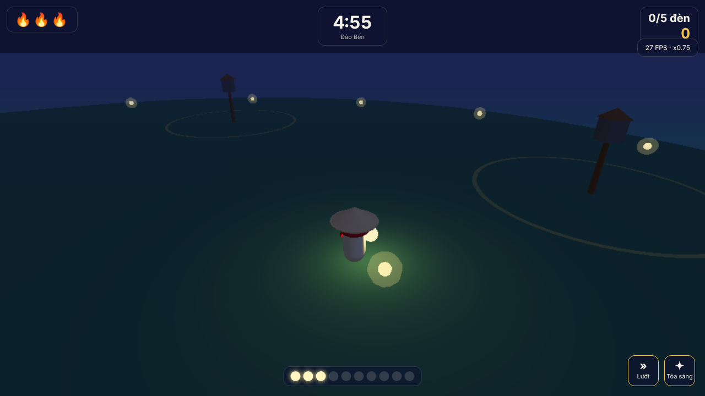

# Đảo Đèn Lồng

> **Video demo:** (sẽ thêm khi có Release `v1.0.0`)

Game 3D góc nhìn thứ ba: **Mây**, người giữ đèn nhỏ tuổi đội nón lá, chạy khắp đảo nhặt đom đóm để thắp lại 5 Đèn Lồng Lớn, và né **Bóng Mực** trong sương đen. Bài Day 12 (AI SDLC) của Nguyễn Khôi Nguyên, MSSV 2A202603453.



Ba Đêm: **Đảo Bến** (đảo tròn), **Đảo Cau** (hai đảo nối bằng cầu tre và bục nhảy, có Gió Lạc và Bùa Gió), **Đảo Chuông** (ba tầng, dốc, bục nhảy lên đỉnh tháp, gió mạnh). Nhật ký làm từng phase: `docs/notes/`.

## Chạy (3 lệnh, Windows / macOS / Linux, cần Node.js ≥ 20)

```bash
npm install      # không có thư viện ngoài (Three.js đã kèm trong web/vendor), lệnh này chạy gần như tức thì
npm run play     # mở http://localhost:8080 trên trình duyệt (đổi cổng: PORT=9000 npm run play)
npm test         # 87 test: Test Contract v1.1, tất định, bot thắng được, lõi thuần
```

Chế độ headless (theo Test Contract v1.1, không cần cửa sổ/GPU; `--night` nhận 1, 2, 3):

```bash
node src/headless/cli.mjs --seed 42 --night 2 --ticks 3000 --out out.jsonl \
  --scenario docs/samples/scenario.example.json --inputs docs/samples/inputs.example.json
```

Bot tự chơi để kiểm tra màn chơi thắng được: `npm run bot -- --night 1` (đứng yên thì thua; thêm `--calm` để tắt kẻ địch và chứng minh mọi đèn trên Đêm 2/3 đều tới được).
Địa chỉ tiện cho người chấm: `http://localhost:8080/web/index.html?autostart&night=3&fps` (vào thẳng Đêm 3, hiện FPS).

## Điều khiển

| Phím | Việc |
|---|---|
| `W` `A` `S` `D` / mũi tên | Đi (theo hướng camera) |
| `Space` | Nhảy (chỉ khi chạm đất) |
| `Shift` | Lướt (14 m/s trong 0,2 s, hồi 1,5 s) |
| `E` | Nạp ánh sáng vào đèn chưa sáng gần nhất (trong 2 m) |
| `F` | Tỏa sáng: tốn 3 ánh sáng, làm choáng và đẩy lùi Bóng Mực trong 5 m |
| Kéo chuột hoặc `Z` / `X` | Xoay camera |
| `Esc` / `P` | Tạm dừng (Tiếp tục / Chơi lại đêm / Cài đặt / Về menu); `R` khi đang tạm dừng: chơi lại đêm |

## Luật chơi ngắn gọn

- Chuỗi: Menu chính → giới thiệu Đêm (lời Ông Đăng) → chơi → kết quả → Đêm kế. Thắng Đêm 3 là Bình Minh với tổng điểm. Thua thì chơi lại đúng Đêm đó.
- Mỗi Đêm có thời gian 300 / 330 / 360 giây và 5 / 6 / 7 đèn. Thắp đủ đèn trước bình minh để thắng. Ngọn Lửa (mạng): 3, đầy lại mỗi Đêm.
- Đi sát đom đóm là tự nhặt (mang tối đa 10). Mỗi đèn cần **10** ánh sáng, nạp bằng `E` (nạp dần được, đèn nhớ tiến độ).
- Bóng Mực phát hiện trong 12 m, đuổi 4 m/s (Đêm 3: 4,5). Chạm: mất 1 Ngọn Lửa, rơi nửa số ánh sáng đang mang, bất tử 1,5 s. Quanh mỗi đèn đã thắp có vòng an toàn 6 m.
- **Gió Lạc** (Đêm 2, 3) cuỗm 3 ánh sáng nếu bạn mang ≥ 5; Tỏa Sáng vào nó thì nó bỏ chạy (nếu đang mang đồ cướp thì thả lại).
- **Bùa Gió** (khăn đỏ): 10 s chạy 7,2 m/s và lướt không hồi chiêu.
- **Bục nhảy** bắn bạn sang đảo kia (Đêm 2) hoặc lên đỉnh tháp (Đêm 3). **Gió mạnh** ở Đêm 3 mỗi 30 s, báo trước 2 s bằng lá bay.
- Rơi khỏi đảo (Y < −10): mất 1 Ngọn Lửa và toàn bộ ánh sáng, hồi sinh ở điểm xuất phát sau 1 s.

## Cách tính điểm

| Sự kiện | Điểm |
|---|---|
| Nạp 1 đom đóm vào đèn | +10 |
| Thắp sáng 1 đèn | +100 |
| Tỏa Sáng trúng 1 Bóng Mực | +5 |
| Thắng: mỗi giây còn lại | +2 |
| Thắng: mỗi Ngọn Lửa còn lại | +50 |

Tổng điểm game = tổng điểm các Đêm đã thắng. Mọi con số nằm trong `game.contract.json` (mục `tuning`, số chuẩn của Ticket-02). Giả định và chỗ tôi đổi so với Phase 1: `docs/notes/assumptions-phase2.md`. Spec và tiêu chí chấp nhận: `docs/spec/phase-2.md`.

## Sáng tạo của tôi

Chỉ là lớp hiển thị, **không đổi gì ở đầu ra headless**: lõi `src/core/` không biết gì về đồ họa hay âm thanh.

1. **Bình minh đến dần.** Khi còn dưới 30% đêm, bầu trời ngả sang hồng cam và sao mờ đi, nên nhìn là biết sắp hết giờ mà không cần liếc đồng hồ.
2. **Ánh sáng phản ánh những gì bạn làm.** Cầu đèn của Mây phình to và đèn tay sáng hơn theo lượng ánh sáng đang mang; đèn lồng chưa thắp sáng dần theo lượng đã nạp; thắp xong có vòng sáng và tia lửa tỏa ra. Cả đảo cũng ấm dần lên theo số đèn đã sáng.
3. **Âm thanh tổng hợp bằng WebAudio**, không dùng file âm thanh nào: tiếng nhặt (cao dần theo số đang mang), nạp, giai điệu ba nốt khi thắp đèn, tiếng tỏa sáng, tiếng bị chạm.

Bằng chứng phần cũ vẫn đúng: `tests/purity.test.mjs` (lõi không dùng `Math.random`, `Date`, DOM; không import ngược từ `web/`; `web/main.js` chỉ gọi `createGame`, `step`, `timeLeft`, `nightDuration`, `WORLD` và đọc dữ liệu bản đồ `NIGHTS`), cùng toàn bộ 87 test và `docs/proof/phase-1/determinism.txt` (hai lần chạy headless trùng hash).

## Cấu trúc

```
src/core/       lõi mô phỏng thuần, tất định (sim, maps = bản đồ 3 Đêm, rng, kiểm tra định dạng)
src/headless/   CLI theo Test Contract
web/            bản chơi 3D (Three.js) dùng chung src/core
scripts/        serve, bot, evidence, tag-phase, stop-gate
tests/          test theo Test Contract, tất định, bot, lõi thuần
docs/           spec (tiêu chí chấp nhận từng phase), notes (giả định, AI log, retro), proof (bằng chứng từng phase), samples, media
```

## Tài liệu

- `AGENTS.md`: hướng dẫn cho agent. Harness nằm ở `.claude/` (hook Stop chặn khi test đỏ, skill `verify`), `scripts/` và CI (`.github/workflows/ci.yml`).
- `docs/spec/`: spec và tiêu chí chấp nhận (AC) từng phase.
- `docs/notes/`: giả định (kèm nguyên văn Test Contract và ticket), nhật ký dùng AI, retro.
- `docs/proof/`: bằng chứng từng phase, do `scripts/evidence.mjs` sinh ra.
- `CREDITS.md`, `LICENSE` (MIT).
