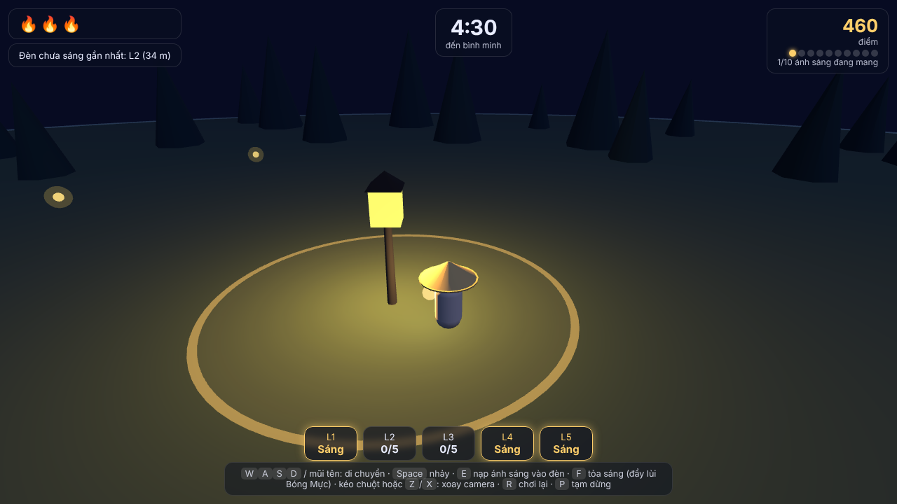

# Đảo Đèn Lồng

> **Video demo:** (sẽ thêm khi có Release `v1.0.0`)

Game 3D góc nhìn thứ ba: **Mây**, người giữ đèn nhỏ tuổi đội nón lá, chạy khắp đảo nhặt đom đóm để thắp lại 5 Đèn Lồng Lớn, và né **Bóng Mực** trong sương đen. Bài Day 12 (AI SDLC) của Nguyễn Khôi Nguyên, MSSV 2A202603453.



## Chạy (3 lệnh, Windows / macOS / Linux, cần Node.js ≥ 20)

```bash
npm install      # không có thư viện ngoài (Three.js đã kèm trong web/vendor), lệnh này chạy gần như tức thì
npm run play     # mở http://localhost:8080 trên trình duyệt (đổi cổng: PORT=9000 npm run play)
npm test         # 53 test: Test Contract, tất định, bot thắng được, lõi thuần
```

Chế độ headless (theo Test Contract v1.0, không cần cửa sổ/GPU):

```bash
node src/headless/cli.mjs --seed 42 --night 1 --ticks 3000 --out out.jsonl \
  --scenario docs/samples/scenario.example.json --inputs docs/samples/inputs.example.json
```

Bot tự chơi để kiểm tra màn chơi thắng được: `npm run bot` (thắng 15/20 seed, đứng yên thì thua).

## Điều khiển

| Phím | Việc |
|---|---|
| `W` `A` `S` `D` / mũi tên | Đi (theo hướng camera) |
| `Space` | Nhảy |
| `E` | Nạp ánh sáng vào đèn gần nhất (trong 3 m) |
| `F` | Tỏa sáng: tốn 2 ánh sáng, làm choáng và đẩy lùi Bóng Mực trong 8 m |
| Kéo chuột hoặc `Z` / `X` | Xoay camera |
| `P` / `R` | Tạm dừng / chơi lại (dùng được cả sau khi thắng hoặc thua) |

## Luật chơi ngắn gọn

- Đêm kéo dài **5 phút**. Thắp đủ **5 đèn** trước bình minh để thắng.
- Đi sát đom đóm là tự nhặt (mang tối đa 10). Mỗi đèn cần **5** ánh sáng, nạp bằng `E` (nạp dần được).
- Bóng Mực đuổi theo Mây (chậm hơn Mây). Bị chạm: **mất 1 trong 3 mạng**, rơi một nửa ánh sáng đang mang, và bất tử 1,5 s. Hết mạng là thua.
- Quanh mỗi đèn **đã thắp** có vòng an toàn bán kính 6 m mà Bóng Mực không vào được.
- Bình minh lên mà chưa thắp đủ đèn cũng là thua.

## Cách tính điểm

| Sự kiện | Điểm |
|---|---|
| Nhặt 1 đom đóm | +10 |
| Thắp sáng 1 đèn | +100 |
| Làm choáng 1 Bóng Mực | +25 |
| Thắng: mỗi giây còn lại | +2 |
| Thắng: mỗi mạng còn lại | +50 |

Mọi con số (tốc độ, bán kính, thời gian…) nằm trong `game.contract.json`, mục `tuning`. Hai mục khai `false`/không có: `fall_enabled: false` (đảo có mép chặn, không rơi) và không có lướt (`dash`). Lý do và các giả định khác: `docs/notes/assumptions.md`.

## Sáng tạo của tôi

Chỉ là lớp hiển thị, **không đổi gì ở đầu ra headless**: lõi `src/core/` không biết gì về đồ họa hay âm thanh.

1. **Bình minh đến dần.** Khi còn dưới 30% đêm, bầu trời ngả sang hồng cam và sao mờ đi, nên nhìn là biết sắp hết giờ mà không cần liếc đồng hồ.
2. **Ánh sáng phản ánh những gì bạn làm.** Cầu đèn của Mây phình to và đèn tay sáng hơn theo lượng ánh sáng đang mang; đèn lồng chưa thắp sáng dần theo lượng đã nạp; thắp xong có vòng sáng và tia lửa tỏa ra. Cả đảo cũng ấm dần lên theo số đèn đã sáng.
3. **Âm thanh tổng hợp bằng WebAudio**, không dùng file âm thanh nào: tiếng nhặt (cao dần theo số đang mang), nạp, giai điệu ba nốt khi thắp đèn, tiếng tỏa sáng, tiếng bị chạm.

Bằng chứng phần cũ vẫn đúng: `tests/purity.test.mjs` (lõi không dùng `Math.random`, `Date`, DOM; không import ngược từ `web/`; `web/main.js` chỉ gọi `createGame`, `step`, `timeLeft`), cùng toàn bộ 53 test và `docs/proof/phase-1/determinism.txt` (hai lần chạy headless trùng hash).

## Cấu trúc

```
src/core/       lõi mô phỏng thuần, tất định (sim, rng, kiểm tra định dạng)
src/headless/   CLI theo Test Contract
web/            bản chơi 3D (Three.js) dùng chung src/core
scripts/        serve, bot, evidence, tag-phase, stop-gate
tests/          test theo Test Contract, tất định, bot, lõi thuần
docs/           notes (giả định, AI log, retro), proof (bằng chứng từng phase), samples, media
```

## Tài liệu

- `AGENTS.md`: hướng dẫn cho agent. Harness nằm ở `.claude/` (hook Stop chặn khi test đỏ, skill `verify`), `scripts/` và CI (`.github/workflows/ci.yml`).
- `docs/notes/`: giả định (kèm nguyên văn Test Contract), nhật ký dùng AI, retro.
- `docs/proof/`: bằng chứng từng phase, do `scripts/evidence.mjs` sinh ra.
- `CREDITS.md`, `LICENSE` (MIT).
